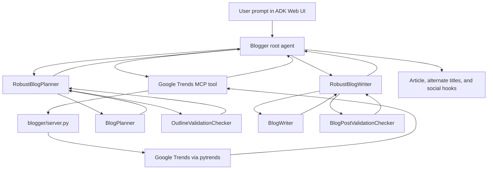

# Agentic AI ADK Blogger

A Google Agent Development Kit (ADK) application that researches a topic with Google Trends, creates and validates an outline, then writes and validates a technical blog post with Gemini.

## How It Works



The MCP server is started by ADK over standard input/output. It is not a separate HTTP service. If Trends is unavailable, the root agent is instructed to continue without it.

## Project Structure

```text
.
├── blogger/
│   ├── __init__.py
│   ├── agent.py       # ADK root agent, planner/writer agents, MCP connection
│   └── server.py      # stdio MCP server exposing the `trends` tool
├── requirements.txt
├── .env               # Local configuration; do not commit
└── README.md
```

## Requirements

- Python 3.14 (the dependencies in this project were verified with Python 3.14)
- `uv` for creating and managing the virtual environment
- A Google Cloud project with Gemini Enterprise Agent Platform / Vertex AI access
- Either Application Default Credentials (recommended) or an appropriate Google Cloud API key

## Setup

Run these commands from the project root:

```bash
uv venv .venv314 --python 3.14
source .venv314/bin/activate
uv pip install -r requirements.txt
```

The environment directory is local and ignored by Git. Activate it before starting ADK. The MCP server is launched using `python3` from the process `PATH`, so activation ensures it uses the same environment as ADK.

### Configure Gemini Enterprise Agent Platform

Create or update `.env` in the project root. Do not commit this file or share its secrets.

For ADC authentication, use:

```dotenv
MODEL=gemini-3.5-flash
GOOGLE_GENAI_USE_ENTERPRISE=True
GOOGLE_CLOUD_PROJECT=YOUR_GOOGLE_CLOUD_PROJECT_ID
GOOGLE_CLOUD_LOCATION=global
```

Replace the project placeholder with the actual **project ID**, not an organization, email, or display name. Use a location and model supported by your project; `global` and `gemini-3.5-flash` are examples from Google's model quickstart, and availability can vary.

Then configure ADC once for your local user:

```bash
gcloud auth application-default login
```

The project must have the Agent Platform API enabled, billing configured where required, and your account must have permission to call the model (commonly `roles/aiplatform.user`). The `gcloud` command-line tool must be installed for the ADC command.

For local testing with a Google Cloud API key instead of ADC, configure the API key without committing it:

```dotenv
MODEL=gemini-3.5-flash
GOOGLE_GENAI_USE_ENTERPRISE=True
GOOGLE_API_KEY=YOUR_GOOGLE_CLOUD_API_KEY
```

With API-key authentication, omit `GOOGLE_CLOUD_PROJECT` and `GOOGLE_CLOUD_LOCATION` unless your chosen API-key mode explicitly requires them. Do not use an API key in client-side code or check it into source control. ADC is preferred for ongoing or production use.

The agent calls `load_dotenv()` when it is imported. Start ADK from the project root so the root `.env` is found.

## Run The Application

With `.venv314` activated and `.env` configured, start the ADK development UI:

```bash
adk web --port 8000
```

Open [http://127.0.0.1:8000](http://127.0.0.1:8000) and select the `blogger` app. Enter a topic as a prompt. The agent will try to fetch related and rising Google Trends queries, choose an angle, generate and validate an outline, write and validate the article, and return alternate titles and short social hooks.

To run the agent in a terminal instead of the web UI:

```bash
adk run blogger
```

Stop the web server with `Ctrl+C`. If port 8000 is already in use, stop the other ADK server or choose an available port, for example `adk web --port 8001`.

## Trends MCP Tool

`blogger/server.py` exposes a `trends` MCP tool backed by `pytrends`. It accepts a required `keyword` plus optional values such as `geo` (ISO country code), `timeframe`, `hl`, and `quick`. The root agent uses a short US Trends window by default. If related queries are empty, the server tries trending-search fallbacks and ultimately returns the keyword as a fallback result. Trends depends on network access and Google's Trends endpoints; failure should not prevent blog generation.

## Troubleshooting

- **`ModuleNotFoundError` for `dotenv`, `google.adk`, or `mcp`:** activate `.venv314` and install dependencies with `uv pip install -r requirements.txt`; make sure the terminal running ADK is using that environment.
- **`No API key was provided`:** the application is using the Gemini API path without a key. Set up ADC or configure `GOOGLE_GENAI_USE_ENTERPRISE=True` and the credentials described above, then restart ADK.
- **Google request returns 404:** verify `GOOGLE_CLOUD_PROJECT` contains the actual project ID, `GOOGLE_CLOUD_LOCATION` contains a supported region (not an organization or project name), and `MODEL` is available for that project and location. Restart ADK after changing `.env`.
- **Permission or authentication error:** verify ADC with `gcloud auth application-default login`, confirm the correct Google Cloud account/project, API enablement, billing, and IAM permissions.
- **MCP server cannot import packages:** launch ADK after activating `.venv314`; `agent.py` starts the MCP process with `python3`, so its `PATH` must resolve to the virtual environment's interpreter.
- **Port 8000 is occupied:** use `adk web --port 8001` or stop the process already listening on port 8000.

## Dependencies

Install the declared dependencies with:

```bash
uv pip install -r requirements.txt
```

`google-adk` provides the agent framework and web UI, `python-dotenv` loads local configuration, `mcp` provides the MCP server SDK, and `pytrends` retrieves Google Trends data.